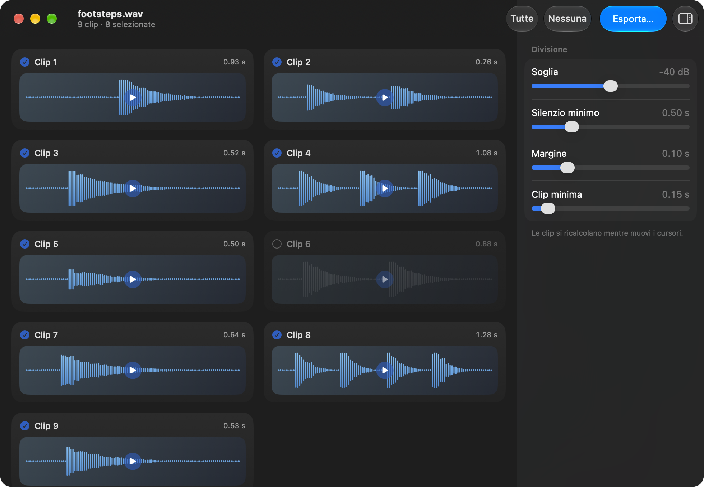

<p align="center">
  
</p>

<h1 align="center">Audio Splitter</h1>

<p align="center">
  A macOS app that cuts one audio file into the separate sounds inside it, using the silences between
  them as the cut points.<br>
  Built with SwiftUI on <a href="https://developer.apple.com/av-foundation/">AVFoundation</a> and
  <a href="https://developer.apple.com/accelerate/">Accelerate</a>, with no dependencies.
</p>

<p align="center">
  
</p>

It was written for sample libraries — a single take holding twenty dice rolls, footsteps or door
slams, that has to end up as twenty files.

## Features

- **Open a file**: drag it onto the window, press **Choose a File…** on the empty window, or choose
  **File › Open…** (⌘O). Every non-silent stretch becomes its own clip. Anything AVFoundation can
  read can go in: WAV, AIFF, CAF, MP3, M4A, and more.
- **Tune the split live**: four sliders in the options panel on the right of the window re-cut the
  file as you drag, without re-reading it. The toolbar button or **View › Hide Options** (⌃⌘I)
  hides the panel.
- **Audition a clip**: each clip is a tile showing its waveform, its number and its length. Click
  the waveform to play the clip, click again to stop. The bars turn from light blue to deep blue as
  it plays, so the tile itself is the progress bar.
- **Leave clips out**: click the circle in the corner of a tile. Deselected tiles fade and their
  waveform goes grey. **All** / **None** in the toolbar select and deselect every clip at once; the Edit
  menu has the same two commands as **Select All Clips** and **Deselect All Clips**.
- **Keep count**: the window title is the file name; the subtitle counts the clips and how many are
  selected.
- **Export as WAV**: **Export…** (toolbar or **File › Export…**, ⌘E) asks for a folder and writes
  only the selected clips, as `<source name> <n>.wav` — `footsteps 1.wav`, `footsteps 2.wav`, and so
  on — then shows the folder in the Finder. Sample rate, channel count and bit depth are taken from
  the source file, so a 16-bit 48 kHz mono recording comes back out as 16-bit 48 kHz mono. The
  original file is never touched.
- **Two languages**: the interface is in English and Italian, following the system language.

## Requirements

- macOS 14 or later. On macOS 26 and later the toolbar and panels use Liquid Glass; earlier
  versions get the standard look of their system, with the same controls.
- Xcode 26 to build (`actool` compiles the Liquid Glass icon)

There are no dependencies, and nothing to install alongside it: reading and writing audio is
AVFoundation, the envelope analysis is Accelerate. No ffmpeg.

## Installation

```bash
git clone https://github.com/giuliomaffei90/audio-splitter.git
cd audio-splitter
./build.sh
open dist/AudioSplitter.app
```

`build.sh` runs `xcodebuild` on the Release configuration, copies the result to
`dist/AudioSplitter.app` and re-registers it with Launch Services so the Finder and the Dock pick up
the new icon. The Xcode target compiles `AppIcon.icon` with `actool` (Liquid Glass on macOS 26 plus
an `.icns` for older systems) and signs the app ad-hoc.

For development, open `AudioSplitter.xcodeproj` in Xcode, or run `./scripts/build_dev_mac.sh`: it
quits the running app, rebuilds it, copies it to `~/Downloads` and launches it again.

The split logic has no dependency on AVFoundation, so it checks on its own:

```bash
swiftc -O -o /tmp/check AudioSplitter/SilenceDetector.swift check/main.swift && /tmp/check
```

It covers the threshold, silences too short to cut, clips too short to keep, a margin large enough to
make clips collide, a file that is all silence and a file with none. The checks use `precondition`
rather than `assert` on purpose — `assert` is compiled out of optimised builds and would pass without
running.

## How it works

1. `Analysis` in [SplitterModel.swift](AudioSplitter/SplitterModel.swift) reads the file once into
   memory with `AVAudioFile` and reduces it to an envelope — one RMS value (`vDSP_rmsqv`) and one
   peak value (`vDSP_maxmgv`) per 10 ms window, taken from whichever channel is loudest, so a sound
   that only appears on one side is never treated as silence.
2. `nonSilentRanges` in [SilenceDetector.swift](AudioSplitter/SilenceDetector.swift) decides where
   the cuts fall. A stretch is silence when its level stays under **Threshold** for at least
   **Minimum Silence**. Everything between two silences is a clip, and anything shorter than
   **Minimum Clip** is dropped. Each clip then grows by **Margin** on both sides so it doesn't start
   and end on an abrupt edge.
3. The margin never lets two clips overlap: it is capped at half the silence next to it, whatever
   value the slider is set to.
4. Moving a slider runs step 2 again on the envelope already in memory, so the whole file is re-cut
   as you drag. Clips you had deselected stay deselected.
5. Each tile in [AudioSplitterApp.swift](AudioSplitter/AudioSplitterApp.swift) draws 110 bars from
   the peak envelope. Bar heights are normalised against the loudest peak in the whole file, not per
   clip, so a quiet clip looks quiet next to a loud one instead of being stretched to fill its tile.
6. [Player.swift](AudioSplitter/Player.swift) plays one clip at a time by scheduling its slice of
   the in-memory buffer on an `AVAudioPlayerNode`.
7. `export` in [SplitterModel.swift](AudioSplitter/SplitterModel.swift) writes each selected slice
   with `AVAudioFile` as integer linear PCM, at the sample rate and channel count of the source.

| Control | Default | Range | What it does |
|---|---|---|---|
| Threshold | −40 dB | −70 to −10 dB | The level under which sound counts as silence. Raise it for quiet recordings, lower it for noisy ones. |
| Minimum Silence | 0.50 s | 0.05 to 2 s | How long a quiet stretch has to last before it splits the file. Shorter values cut more. |
| Margin | 0.10 s | 0 to 0.5 s | Silence kept at both ends of every clip. |
| Minimum Clip | 0.15 s | 0.02 to 2 s | Clips shorter than this are thrown away — it removes clicks and breaths. |

## Known limitations

- The whole file is held in memory as 32-bit float — roughly 23 MB per minute of 48 kHz stereo. That
  is what makes re-cutting instant while you drag a slider, and it is fine for the takes this app is
  for; hours-long files would want block-by-block reading instead.
- Output is always WAV. A source that is not PCM (MP3, M4A) is exported at 24 bit.
- One file at a time: dropping several files opens only the first.
- When a slider changes the number of clips, a deselection stays with the position in the list, not
  with the sound: the third clip stays deselected even if it is now a different stretch of audio.

## Structure

```
AudioSplitter/
  AudioSplitterApp.swift   window, drop zone, tiles, waveform
  SplitterModel.swift      file reading, envelope, slicing, WAV export
  SilenceDetector.swift    where the cuts fall — pure logic, no AVFoundation
  Player.swift             playback of one clip from the in-memory buffer
  AppIcon.icon             icon (Icon Composer document)
  Localizable.xcstrings    English translations (the source strings are Italian)
check/                     checks for the split logic
scripts/                   development build
docs/                      icon and screenshot for this README
```

## License

[MIT](LICENSE).
